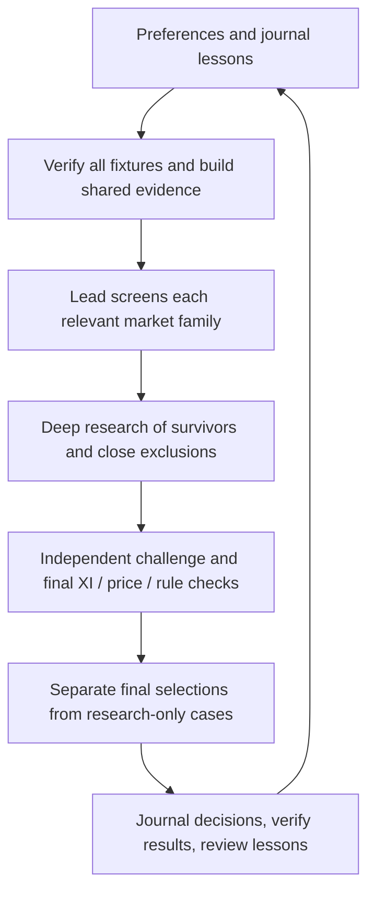

# Football skills — quick map

## Shared process

| Skill | Process | Decision it must justify |
|---|---|---|
| [Wins / BTTS](skills/football-wins-btts/README.md) | Screen → compare both teams → assess tactics/draw risk → test price and XI | Why this team can win, or how **each** side can score |
| [Other markets](skills/football-other-markets/README.md) | Identify plausible event → inspect exact-line counts and failures → test game states → compare alternatives | Why this total, handicap, corner or card line expresses the evidence |
| [Bet builders](skills/football-bet-builders/README.md) | Verify offered markets → player counts/minutes/roles → opponent exposure → assess each leg → check dependence and actual joint quote | Why every leg is supported and the combination survives plausible game states |
| [Journal](skills/football-journal/README.md) | Preserve original decision → append sourced outcome → compare process with result → record testable lessons | What happened, what was known beforehand, and what should change |

## Models and responsibility

- **Astra High/Extra High:** recommended lead for demanding research; owns interpretation and final decisions **when selected**.
- **Luna Medium:** bounded source retrieval/extraction with dates, counts, missing fields and links.
- **Sol High:** focused independent challenge; the lead resolves disagreements.
- **Code:** arithmetic, duplicate checks and journal validation.

The skill does not switch the lead model. A Sol-led chat remains Sol-led unless explicitly changed. Worker routes must be selected explicitly and unavailable routes disclosed. These assignments are workflow recommendations, not measured football forecasting superiority. See [routing details](skills/football-wins-btts/references/model-routing.md).

## Both teams' tactics

Assess attack versus defence in **both directions**: press/build-up, wide overloads and cover, space behind full-backs, transitions, set pieces and aerial/ground-duel opportunities. Check how current managers, personnel, roles and game states change those interactions. For player markets, connect the interaction to actual event opportunities. Label tactical inference and missing evidence; never invent marking assignments or equate duel-win percentage with event volume.

## Why the process is comprehensive

It combines broader and recent comparable evidence, checks both teams, retains failed observations, verifies current roles and exact market terms, challenges counterevidence, and preserves original decisions for review. Finalists receive deep research; every fixture receives a documented screen. More statistics or longer explanations alone do not improve a decision.

## Cost optimisation: current status

| Implemented | Still requires evidence or research |
|---|---|
| Variable-scope collector, shared cache, explicit model routes and bounded staged runner; token/call telemetry; comparative cost and prospective evaluation tools | Verified live news/player/odds enrichment; measured whole-workflow savings from comparable executions; demonstrated prospective forecasting advantage |

For the user's typical day: screen all 44 games for wins/BTTS and other markets, deepen warranted cases, and research builders separately for **at most five specified fixtures**. There is no fixed shortlist quota. The lead owns exclusions and checks promising cases with weak coverage; missing information does not silently remove a fixture.

44 is an example, not a program limit: scope always follows the request. Read the [pipeline guide](pipeline/README.md) for execution and current boundaries. Core skills retain tactical freedom; code enforces evidence/scope/timing rules, not numerical football feature weights.

**Read next:** [copyable prompts](USAGE.md), [journal instructions](journal/README.md), [active lessons](journal/active-lessons.md).
