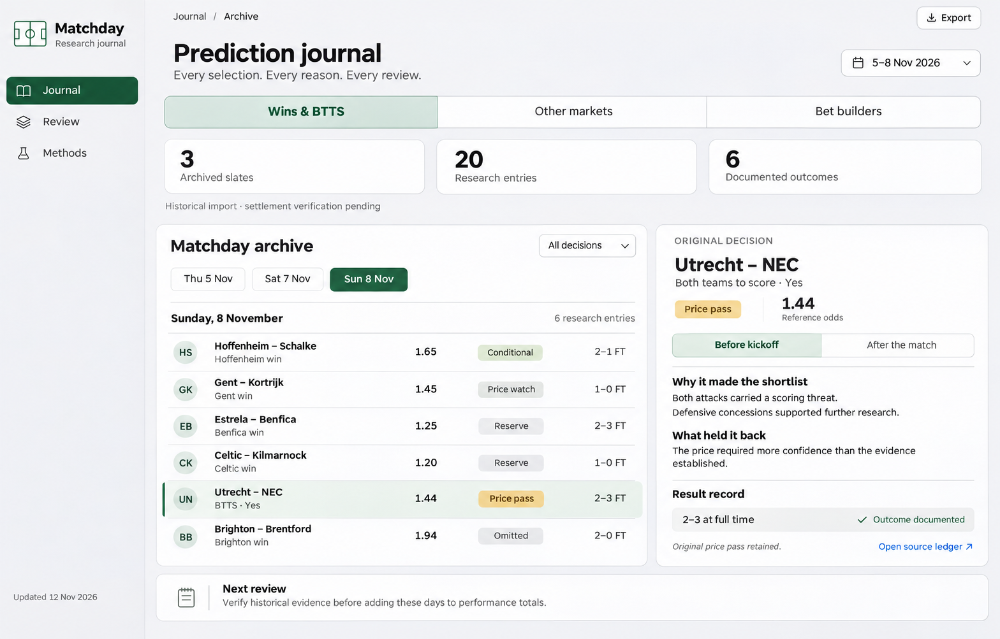

# Matchday — journal design and build handoff

**Status: design complete; application, archive skill and recurring checks not yet built or enabled.** Prepared 12 November 2026. This pack belongs to the existing football-research-skills repository. It specifies a small, polished website that a less expensive implementation model can build without redesigning the product.

Matchday preserves what we predicted, why we predicted it, what we decided at the available price, and what actually happened. It should make reviewing a research decision feel as clear as reading a well-designed notebook.

The image is an original generated design reference, not a functioning site or verified performance dashboard. Its historical counts describe the import inventory below. Written specifications take precedence over abbreviated mockup labels.

## Read in this order

1. [DESIGN.md](DESIGN.md): appearance, layouts, interactions, mobile behavior and accessible states.
2. [DATA-CONTRACT.md](DATA-CONTRACT.md): records, provenance, revisions, results and honest metrics.
3. [HISTORICAL-IMPORT.md](HISTORICAL-IMPORT.md): the first three slates, their 20 entries and what is still unverified.
4. [WORKFLOWS.md](WORKFLOWS.md): capture, refresh, verify and improve; proposed archive skill and schedule.
5. [BUILD-PROMPT.md](BUILD-PROMPT.md): copy-and-paste instructions for implementation, including acceptance checks.

## Product decisions

- Three research tabs: **Wins & BTTS**, **Other markets**, **Bet builders**. Journal, Review and Methods are the main navigation sections.
- A selection opens a **Before kickoff / After the match** evidence panel. Original reasoning stays visible after a result is recorded.
- Store structured data as **JSON in Git**, with one immutable research snapshot per slate/revision and separate verification records. Keep private account evidence outside the public repository.
- Use HTML, CSS and modest vanilla JavaScript. A small validation/index-generation script is useful; a framework, paid database and live sports API are unnecessary for the first version.
- Keep the website read-only. An agent running the future archive skill writes validated files. Export downloads a copy; it does not update the repository.
- Preserve research status, user inclusion, match outcome and settlement as separate facts. A winning reserve or pass is still a reserve or pass.
- Show documented historical evidence without presenting it as a prospective backtest. The initial import has three slates, 20 entries and six outcomes documented in a saved audit. It does not establish three verified winning accumulators.

GitHub Pages is a suitable later hosting option for repository HTML/CSS/JavaScript. Deployment is a separate implementation step; this pack does not enable it. [GitHub Pages documentation](https://docs.github.com/en/pages/getting-started-with-github-pages/what-is-github-pages).

## Implementation sequence

| Phase | Deliverable | Completion test |
|---|---|---|
| 1 — Data and shell | Contract validation, historical import with honest provenance, navigation, category/date filters and selection details | The 20 inventoried entries render; missing information is labeled; no invented scores or forecasts |
| 2 — Finished website | Responsive visual implementation, Review and Methods, source links, downloads, error states | Desktop/mobile inspection and the cases in BUILD-PROMPT.md pass |
| 3 — Archive workflow | New football-journal skill, capture/refresh/verify/review modes, instructions for existing skills | Idempotent imports and append-only revisions tested with fictional cases; original decisions survive |
| 4 — Recurring checks | A dry-run verified; then a separately enabled schedule in the app | Clear model routing, timezone, bounded work and unresolved-case handling |

Build phases 1–2 first. Do not turn the mockup into a single screenshot embedded in a page. Do not invent a working archive skill or enabled automation in the interface before they exist.

## Why keep this journal?

It can expose repeated weaknesses—overreliance on small samples, unconfirmed minutes, expensive lines, missing opponent evidence—and make research reproducible. Record successful decisions and failed ones, together with important exclusions. Changing methods only after a win or loss encourages hindsight; propose changes from repeated, comparable evidence and evaluate the new version on future slates.

The first release deliberately omits account balances, actual stakes, celebratory streaks and profit charts. A future hypothetical-return analysis needs a complete, explicitly defined cohort and exact settlement rules; it must not imply actual wagering returns.

## Handoff checks completed

The inventory parses and contains three slates, 20 unique entries and six documented outcomes. Exact fractional conversions, null forecasts, historical labels, original pass/omission states, local document links and a private-marker scan passed. A focused independent review identified the scoring-snapshot and push-market break-even ambiguities; both were clarified in the contract and design. The concept image was visually inspected. These are design/data checks, not tests of a built website or a fresh verification of historical results.

## Design references

- [Aura — Minimalist Apple Store Dashboard, Amirreza Taghavi](https://dribbble.com/shots/24351232-Aura-Minimalist-Apple-Store-Dashboard): inspiration for calm spacing, light surfaces and subtle depth.
- [Live Sports Analytics Dashboard, VALMAX](https://dribbble.com/shots/26961358-Live-Sports-Analytics-Dashboard): inspiration for fixture grouping and readable data hierarchy.

Both references were visually inspected. Their artwork is not bundled or copied. The Matchday composition, restrained green palette and evidence-first structure are original. [Image generation prompt](assets/desktop-concept-prompt.md).
